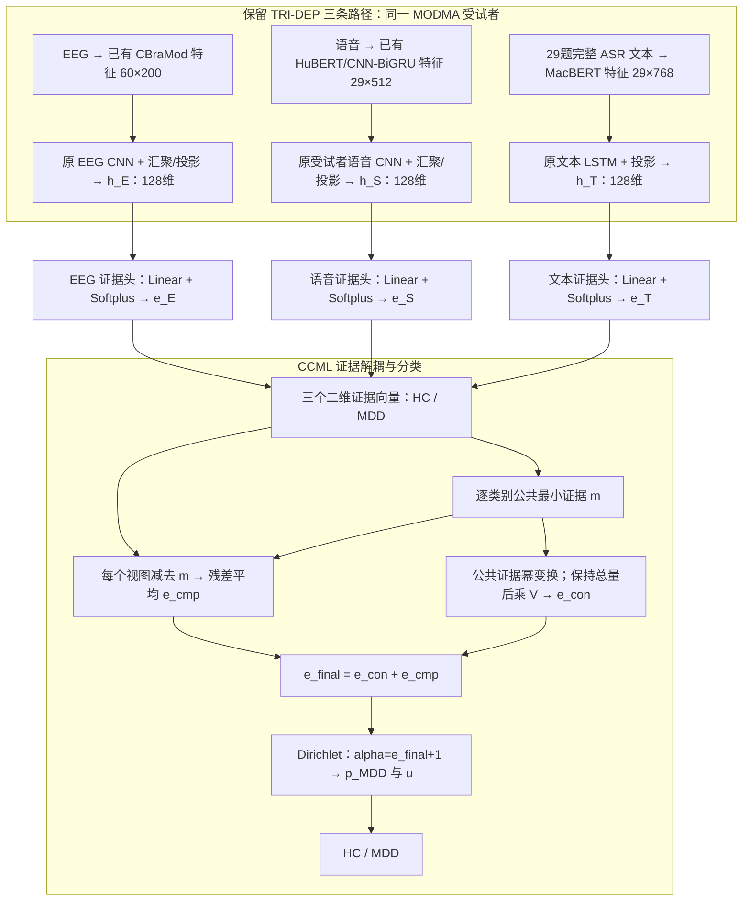

# MODMA：TRI-DEP + CCML 证据解耦与分类实验计划

日期：2026-09-17。状态：**新候选计划，尚未实现、未开始训练，未产生新结果。**

用户最新决定：之前的方案暂时保留；现在以 TRI-DEP 为基础加入 CCML，数据集使用 MODMA。本计划独立于此前 DAIC-WOZ 的 A/B 方案，不要求完成 S01–S15，不引入问题条件、交叉注意力或额外语音文本联合分支。

## 1. 目标与主方案

**保留 TRI-DEP 的 EEG、语音、文本三条编码路径，将末端普通分类头改为证据分类头，以 CCML 的一致/互补证据解耦替代原最终概率加权融合。**

三个输入均来自同一位 MODMA 受试者。模型输出 MDD 概率、HC/MDD 分类和证据不确定性。EEG 在新方案中是正式模态，不再是扩展接口。

首轮以已完成的 `B0-37-fulltext` 为父实验：复用同折同种子的已训练三分支表征，仅训练新末层；有必要时再进行从缓存特征开始的三分支联合训练。全文版的文本输入选择保持不变，避免把转写范围改动混入 CCML 收益。

| 保留 | 改动 |
|---|---|
| MODMA-37 人群、作者划分移除损坏受试者后的原五折、种子 | 三个末端 `Linear(128,2)` 后采用 Softplus 产生证据 |
| CBraMod、HuBERT、MacBERT 及当前预处理/特征缓存政策 | 普通 CE 分类目标改为单视图与一致/互补证据目标 |
| EEG CNN、语音受试者 CNN、文本 LSTM 的现有结构 | 最终加权概率融合改为单层 CCML |
| 每人 29 题、完整 ASR 文本、临床 HC/MDD 标签 | 增加证据、不确定性、校准与融合消融记录 |

之前已有的 `p_E/p_S/p_T` 可继续用于基线比较，但不是新 CCML 的输入。新分支必须从受试者特征产生 `e_E/e_S/e_T`；不能仅在旧 softmax 概率后面接一个解耦公式。

## 2. 数据与已有基线

- 数据：`MODMA-37-v1`，37 人，16 MDD、21 HC，37 份 EEG 和 1073 份录音；每人 29 题。
- 标签固定 `0=HC, 1=MDD`，所有概率指向 MDD。不是 DAIC 的 PHQ-8 阈值标签。
- 人群锁：[S00/configs/cohort.json](../../S00/configs/cohort.json)；划分：[S00/manifests/fold_assignments.json](../../S00/manifests/fold_assignments.json)。
- 划分 SHA-256：`a28ebe92c94428128313586d3a5524b2f03befcbc473215f4b0b2dcb49c3284d`。
- 种子 11、22、33；额外 44、55 仅用于后续优化稳定性确认，不能当作新增受试者。
- 原因明确的被排除受试者 `[受试者编号已省略]` 不恢复。`B-all` 的 38 人准备目录不混入本轮。

| 外层折 | train | val | test |
|---|---:|---:|---:|
| 1 | 27 | 3 | 7 |
| 2 | 26 | 3 | 8 |
| 3 | 26 | 3 | 8 |
| 4 | 27 | 3 | 7 |
| 5 | 27 | 3 | 7 |

已有全文版结果，来自[全文版本对照报告](../../S00/reports/全文版本对照报告.md)及[机器可读汇总](../../S00/reports/fulltext_comparison.json)：

| 输出 | Macro-F1 |
|---|---:|
| EEG | 0.4494 |
| 语音 | 0.6300 |
| 文本（全文） | 0.7231 |
| 原三模态融合 | 0.7242 |

以上是先对每个种子的五折取均值，再对三个种子取均值，**不是新模型成绩**。这些测试结果此前已经查看，后续同划分实验属于开发性比较，不称为新的独立盲测。原首段版融合 0.6644 只作历史背景；不能让新全文模型只与它比较并把差值归因于 CCML。

## 3. 新模型架构

这是受试者级融合：EEG 的 60 个片段与语音/文本的 29 个回答分别在原分支内部汇聚，不按片段位置强行配对，也不把静息 EEG 说成与访谈逐题同步。三个模态属于同一人即可进行这种晚期融合，但仍需保留它们的采集条件差异。

语音与文本均来源于访谈，不能假定三种证据统计独立；CCML 也不自动保证校准或处理所有模态冲突。

## 4. 本地实际接入位置与复用方式

结构定义位于 [S00/upstream-dev/lib/models/models.py](../../S00/upstream-dev/lib/models/models.py)。本地核查结果如下：

| 分支 | 缓存输入 | 分类前路径 | 只替换的末层 |
|---|---|---|---|
| EEG | `[B,60,200]` | 两次 Conv/MaxPool → Flatten 1920 → Linear 1920→128 → ReLU/Dropout | `EEGConvPoolClassifier.classifier[5]`，128→2 |
| 语音 | `[B,29,512]` | 两次 Conv/MaxPool → Flatten 3584 → Linear 3584→128 → ReLU/Dropout | `SpeechConvPoolClassifier.classifier[5]`，128→2 |
| 文本 | `[B,29,768]` | 两层单向 LSTM(hidden=1024)，最后时间步 → Linear 1024→128 → ReLU/Dropout | `LSTM1Classifier.classifier[3]`，128→2 |

首轮移除旧末层，保留 128 维表征。冻结全部上游模块并设为 eval，避免冻结参数但 Dropout 仍随机。三个新末层分别为 `Linear(128,2)`，参数不共享，共 `3×(128×2+2)=774` 个可训练参数；Softplus 和 CCML 解耦器没有可训练参数。

每个种子、每个外层折独立加载父权重：

- EEG/语音：`S00/runs/B0-37/seed_<seed>/fold_<k>_eeg.pt`、`fold_<k>_speech.pt`。
- 文本：`S00/runs/B0-37-fulltext/seed_<seed>/fold_<k>_text.pt`。

加载时核对 `seed/fold/train_ids/cohort_id/folds_sha256` 与权重哈希。该折的表征只允许由该折 train 拟合；不得把别的折模型生成的特征混进来。监督分类前表征缓存必须带折号，不能跨折共享。

原始骨干特征如未在 MODMA 监督拟合，可按既定来源规则复用；语音的随机冻结编码器按种子匹配。已有三条分支的普通预测只用于复核旧基线，不通过 `p→e` 人为指定证据总量。

## 5. 证据分类与 CCML 融合公式

设视图集合 `v∈{E,S,T}`，`V=3`、`K=2`，类别顺序 `[HC,MDD]`。每个头输出：

\[
e^{(v)}=\operatorname{Softplus}(W_vh_v+b_v),\quad
\alpha^{(v)}=e^{(v)}+\mathbf1,\quad
S^{(v)}=\sum_k\alpha_k^{(v)}.
\]

\[
p_k^{(v)}=\alpha_k^{(v)}/S^{(v)},\qquad u^{(v)}=2/S^{(v)}.
\]

`p` 使用 Dirichlet 均值，不再对证据做 softmax。`u` 是模型定义的证据不足度，不是出错概率或临床风险。

采用此前核对的 CCML 官方 `Evidence_DC` 计算顺序：

\[
m_k=\min_v e_k^{(v)},\quad
r_k^{(v)}=e_k^{(v)}-m_k,\quad
e_{\mathrm{cmp},k}=\frac{1}{3}\sum_vr_k^{(v)}.
\]

令 `M=sum_k m_k`，幂参数记作 `rho`：

\[
e_{\mathrm{con},k}=
\begin{cases}
3M\dfrac{m_k^\rho}{\sum_j m_j^\rho},&M>0,\\
0,&M=0.
\end{cases}
\]

\[
e_{\mathrm{final}}=e_{\mathrm{con}}+e_{\mathrm{cmp}},\quad
\alpha_{\mathrm{final}}=e_{\mathrm{final}}+\mathbf1,\quad
p_{\mathrm{MDD}}=\frac{\alpha_{\mathrm{final},1}}{\sum_k\alpha_{\mathrm{final},k}},\quad
u=\frac{2}{\sum_k\alpha_{\mathrm{final},k}}.
\]

残差减的是未放大的 `m`，不能减 `3m` 或变换后的 `e_con`。`rho=1` 时不做分离增强；两类公共证据相等时，幂变换不会凭空增加区分。最后为一致证据与互补证据相加，遵循官方代码行为。

分类保持 `p_MDD>0.5` 判 MDD，等于 0.5 判 HC。数值实现先保护归一化分母，并在公共证据全零时返回零一致证据，始终保证 `e>=0`、`alpha>=1`；不能用把非法 Dirichlet 参数改成 0 的事后修补。若三个头均零证据，则应得到 `[0.5,0.5]` 和 `u=1`。

## 6. 训练损失

令 `y` 为 one-hot 标签，定义期望交叉熵与去除真实类别证据后的 KL：

\[
D(\alpha,y)=\sum_k y_k\left[\psi\left(\sum_j\alpha_j\right)-\psi(\alpha_k)\right],
\]

\[
R_t(\alpha,y)=\lambda_t\operatorname{KL}
\left[\operatorname{Dir}\big(\mathbf1+(\mathbf1-y)\odot(\alpha-\mathbf1)\big)
\;\|\;\operatorname{Dir}(\mathbf1)\right],\quad
\lambda_t=\min(1,t/T_{\mathrm{anneal}}).
\]

一致、互补参数分别为 `alpha_con=e_con+1`、`alpha_cmp=e_cmp+1`。完整目标：

\[
L=\sum_{v\in\{E,S,T\}}[D(\alpha^{(v)},y)+R_t(\alpha^{(v)},y)]
+D(\alpha_{\mathrm{con}},y)+\delta R_t(\alpha_{\mathrm{con}},y)
+\gamma D(\alpha_{\mathrm{cmp}},y).
\]

单视图和一致部分都有 KL 约束，互补部分只有期望交叉熵。官方实现没有额外的最终融合 CE，首轮也不加入。三个单分支损失对每人求和，再对 batch 中受试者取平均；不在不同实验中切换求和/平均。

本地原 TRI-DEP 采用无类别权重的 CE，因此新主实验也不新增类别重加权或重采样。若后续研究类别加权，须给 CE 与 CCML 同样政策并另立实验，不照搬先前 DAIC 方案的权重规则。

## 7. 分阶段实验矩阵

新系列命名为 `TC-<阶段>-37-fulltext`，与旧 S01–S15 和 DAIC 实验分开。下表中的“重训”指新头；表征默认冻结。

| 阶段 | 训练与融合 | 回答的问题 |
|---|---|---|
| TC-00 | 复核已有 B0-37-fulltext；保留原按 val 选权重的融合，并从相同原始概率补算等权融合 | 当前基线与特征来源是否可重复 |
| TC-01 | 三个新 CE/softmax 头；等权概率平均 | 相同冻结表征、相同新增训练预算的直接对照 |
| TC-02 | 三个 Softplus 证据头，仅单视图 `D+R`；仍对三个均值概率等权平均 | 证据头及其损失是否有效 |
| TC-03-mean/sum/ccml | **复用 TC-02 权重，不重新训练**；分别采用证据均值、证据求和、CCML 规则 | 只改变推理融合规则有何影响 |
| TC-04 | 三个证据头用完整 CCML 目标重新训练，采用 CCML 推理 | 一致/互补分开训练的完整候选是否有效 |
| TC-05a/b/c | 从 TC-04 的共同初始化分别重训：`rho=1`、`delta=0`、`gamma=0`，一次只改一项 | 分离增强、一致 KL、互补监督各有什么作用 |
| TC-06（第二阶段） | CE 对照与完整 CCML 同时解冻三分支 CNN/LSTM/投影，骨干及预提取特征仍冻结 | 表征随证据目标联合适配后是否仍有收益 |

TC-01/02/04 使用同一组新末层初始权重、相同受试者 batch 顺序、相同折/种子/更新预算，分别独立运行，不能把 TC-02 训练后的头再额外训练 TC-04 而不给对照等量预算。TC-05 也从相同初始状态训练，不是在已训练完整模型上接着删项训练。

TC-03 中证据均值与求和在同一组证据上的 argmax 相同，但概率及 `u` 不同，应比较校准和强度，不能把两者预设为准确率不同。普通概率平均没有唯一的证据总量，不给它虚构 Dirichlet `u`。`gamma=0` 仅删除互补监督，推理仍含互补证据；不能把这个实验称为删除互补分支。

首轮至少完成 TC-00–04，完整报告预设矩阵。TC-05 用于机制核验，TC-06 作为后续联合训练，不顺便加入新编码器、问题条件或注意力模块。

## 8. 第一轮固定训练协议

以下为新头实验的预设起点，不宣称是已验证的最优设置：

| 项目 | 固定设置 |
|---|---|
| 训练对象 | 3 个独立 `Linear(128,2)`；上游表征全部冻结、eval |
| 初始化 | 新末层按种子固定；TC-01/02/04 共用初始参数副本 |
| 优化器 | Adamax，lr=0.001，weight_decay=0 |
| 受试者 batch / 轮数 | batch=8，60 epochs，最后一轮 |
| 梯度处理 | 最大范数 1，所有新头对照一致；非有限损失/梯度即停止并记录 |
| CCML 参数 | rho=1.25，delta=1，gamma=1，T_anneal=50；t 按 epoch |
| 类别政策 | 无类别权重、无重采样 |
| 阈值 | 0.5，平局为 HC |
| 验证选择 | 首轮无超参数搜索、无选 epoch、无新概率门控或校准器拟合 |

原 EEG/语音/文本的训练轮数和 batch 分别不同，不能把新三模态联合训练笼统称为“完全沿用原训练设置”。TC-00 原结果保留原设置；TC-01–05 用统一的新头预算进行直接比较。

TC-06 的预设为从同折父表征重新初始化、配对相同新末层，训练 60 轮、batch=8；Adamax 对所有新末层 lr=0.001，对 EEG/语音 CNN 与文本 LSTM/投影 lr=0.0001，weight_decay=0、梯度范数上限 1。两种方法采用同一分组与预算，恢复训练模块原 Dropout。这里的“联合训练”仅从缓存特征开始，**不是原始 EEG/音频/文本到骨干的全链路微调**。

## 9. 小样本选择规则与泄漏边界

- 每折仅 3 人 val，不在其上反复搜索 rho、学习率、阈值、融合权重和轮数。首轮按固定设置完成预设比较，任何事后改参数均新建实验 ID 并完整记录。
- TC-00 的原权重选择保留为历史基线政策；新直接对照采用等权融合，避免把 3 人验证调权的波动与 CCML 改动混在一起。
- 不因查看某个 test 折表现差就更换该折模型或参数。不把全体 37 人的测试概率重新拿来训练 C；新头及完整损失只在各折 train 上拟合。
- C 本身是无可学习参数的规则，三个证据头可以按常规监督训练。若以后额外拟合校准器或堆叠模型，必须另用训练内受试者级 OOF 或独立校准集。
- 若后续启动嵌套内层选择，不能复用已用整个外层 train 标签训练过的 128 维表征来生成内层验证/OOF；所有有监督拟合的 CNN/LSTM/头和相关选择须在每个内层训练子集中重做。无目标监督的冻结骨干缓存可按来源规则复用。
- 五折验证结果汇总只能描述已固定方案，不据此回填各折新参数；不同折模型的训练集可能包含其他折的测试人，不能把跨折汇总当成统一、未见过数据的调参集。
- 本轮外层结果一律标注“固定划分开发比较”。增加随机种子或在同一人群重新划分不会产生新的独立人群验证。

是否继续投入的预设工程参考：在直接配对的固定方案间，平均 Macro-F1 提高至少 0.01、至少 2/3 种子同向，MDD recall 平均下降不超过 0.05，且报告 NLL/Brier 是否恶化。它不是统计显著性标准；用于后续投入决策时也必须承认已使用开发性结果，不能再把同一批结果包装成独立确认。

## 10. EEG 的贡献与可信性检查

EEG 当前单分支 Macro-F1 为 0.4494，意味着必须检查这条路径在现有协议中的作用，不能预设三模态一定优于语音文本。CCML 的逐类别 min 也可能被较弱视图限制，不等于自动把弱 EEG 权重调为零。

预先设置：

1. 分别报告 E、S、T 单模态及完整 E+S+T。
2. 在 TC-02 固定输出上比较 S+T、E+S、E+T、E+S+T，作为无需重训的意见子集诊断；使用实际 V。完整 CCML 子集模型若另行重训，单独命名报告，不能混为同一对照。
3. 对零公共证据、意见完全相同、强冲突意见、复制意见及单模态扰动进行数学/工程检查；扰动幅度与处理方式在正式比较前固定，扰动不是临床数据或真实分布外验证。
4. 若去掉 EEG 更好，仍报告完整三模态候选结果；将“两模态更适合当前实现”作为结果，不能悄悄改输入后仍声称证明了三模态改进。

保留当前语音随机冻结编码器/单位置注意力、EEG 尺度和通道对应等已披露限制。CCML 不会自动修复这些特征问题；修复须另设父版本和对照，避免同时改变多个因素。

## 11. 指标与输出

主指标沿用受试者级 Macro-F1，辅以 MDD recall、balanced accuracy；保持旧报告“每种子五折均值→三种子均值”的口径，同时单独提供每种子 37 人合并测试预测的指标，不能混淆两种汇总。

可信性记录二分类 NLL、Brier、每种子 37 人合并预测的 5 个等宽箱 ECE/可靠性图、正确与错误预测的 `u` 分布，以及按 `u` 排序的风险—覆盖率曲线。小样本图表只作描述性证据；不在每折 3 人 val 上拟合或依靠 ECE 选模型。种子和折不视为新增独立受试者。降低 `u` 本身不作为成功标准。

每行预测包含：实验 ID、cohort/fold 哈希、受试者、seed、fold、split、label、父权重/特征哈希、train IDs 来源、适用的三组 `e/alpha/p/u`、公共 `m`、`e_con`、`e_cmp`、`e_final`、`p_final`、`u_final`、预测类别、rho/delta/gamma 与训练配置哈希。`fusion_method` 按实际方法填写 `weighted_probability/mean_probability/mean_evidence/sum_evidence/ccml`；非适用字段为空。普通概率平均不填写虚构的 `e_final/u_final`，CCML 不伪造标量概率融合权重。

未来实现放入独立 `tridep_ccml/` 目录，拟输出 `tridep_ccml/runs/TC-<阶段>-37-fulltext/seed_<seed>/`。已有 `S00`、`B-all` 和 DAIC 的权重、概率、报告均保留。

现有 `cohort.validate_prediction_records` 拒绝未注册实验名，旧 schema 也没有证据字段。实现阶段需要在保持人群/划分哈希不变的前提下，受控注册新 ID 并增加独立证据 schema；不得绕过人群检查或修改旧结果冒充新实验。本轮只制定计划，不修改这些运行配置。

## 12. 实施顺序与完成标准

1. 复核父权重、全文特征和人群锁；重载确认 TC-00 来源，不重新跑 ASR 或骨干提取。
2. 按 fold/seed 导出三个 128 维受试者表征，检查同人三模态对齐及拟合名单。
3. 在新目录实现证据头、稳定解耦、损失和记录 schema，先用合成输入检查非负、零证据、置换等变/不变、梯度有限、保存重载一致。
4. 固定计划配置后运行 TC-01/02；复用 TC-02 做 TC-03；再独立训练 TC-04。
5. 汇总全部种子/折、可信性指标和 EEG 子集诊断；按计划进行 TC-05 消融，必要时推进配对的 TC-06 联合训练。

完成标准：每个训练实验有 3 种子×5 折的可追溯权重与结果，每人每种子仅测试一次；直接对照预算一致；不覆盖父实验；如未改善如实保留结论。图示始终标明候选，直到实际实验支持对应结论。

## 13. 依据与与原文的差异

- 本地父实验：[全文配置](../../S00/configs/b0_fulltext.json)、[全文协议](../../S00/configs/protocol_fulltext.json)、[模型源码](../../S00/upstream-dev/lib/models/models.py)、[全文训练入口](../../S00/scripts/fulltext_b0.py)、[完成报告](../../S00/reports/全文版本对照报告.md)。
- 论文：[本地 CCML PDF](../../baseline备选/面向可信多视图学习的动态证据解耦.pdf)，Dynamic Evidence Decoupling for Trusted Multi-view Learning，ACM MM 2024，[DOI](https://doi.org/10.1145/3664647.3681404)。
- 官方实现：[model.py](https://github.com/Lihong-Liu/CCML/blob/master/model.py)、[loss_function.py](https://github.com/Lihong-Liu/CCML/blob/master/loss_function.py)、[main.py](https://github.com/Lihong-Liu/CCML/blob/master/main.py)。依据本会话 2026-09-17 的只读核查；实现时须固定提交和文件哈希。

正文的 ReLU/部分融合记号与代码不完全一致，本计划采用官方 Softplus、先减未放大 min、公共证据增强后乘 V、最终求和以及代码中的损失组合，并显式修正零公共证据数值处理。首轮冻结父表征、统一新头训练预算和 MODMA 三模态接入属于本项目适配；不能称为原论文已经验证过的抑郁模型。

旧计划的状态见[计划索引](README.md)：之前的 DAIC 与 A/B 设计仅暂时保留，正文和对应文件均不被本次新计划覆盖。
