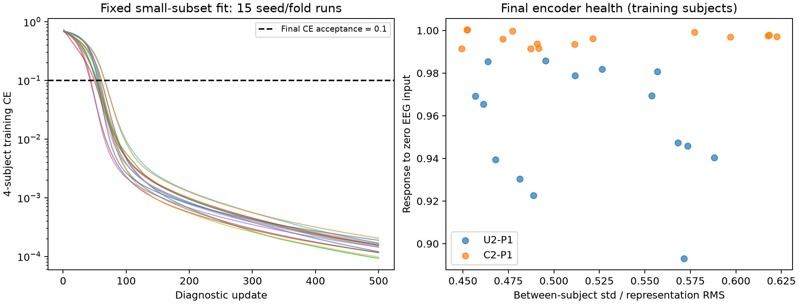
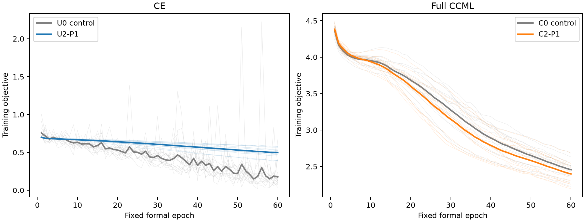

# EEG-P1：有效学习验收与 SparNet 修复执行报告

已完成后续优先级 1。全程使用原始 EEG 派生输入，无训练数据增强。原 R1 的源文件与 986 项冻结产物保持不变。

**结论：有效学习验收和 SparNet 退化修复已完成；单独 EEG 的 F1 有所提高，CCML 内的 EEG 分支仍未改善。两条路线均未通过完整可用性门槛。**

- 单独 EEG（U2-P1）：测试 F1 从旧退化版的 0.361772 升至 0.467364；相对原 U0 控制的 0.399841 提高 0.067523。改善门槛通过，但 BA=0.492778、MDD 召回=0.355556，仍未达到 BA>0.5 且 MDD 召回≥0.5 的可用性要求。
- CCML 的 EEG 分支（C2-P1）：测试 F1=0.342272，低于旧退化版的 0.361772 和原 C0 控制的 0.434149。融合 F1=0.780885，相对 C0 的 0.790859 下降 0.009974，虽刚好落在原定最多下降 0.01 的保持门槛内，整体接入仍不通过。
- 原先的零梯度、常数表示问题已被训练数据上的检查排除。修复后的 U2/C2 训练 F1 分别为 0.769331/0.604902，而测试 F1 为 0.467364/0.342272，仍存在明显训练—测试落差。因此本轮不能把剩余低 F1 继续归因于已修复的死分支，也不能据此证明 EEG 没有预测信息。

## 工程修复及验收

- 修复频谱数值尺度：FFT forward 改为 ortho，即固定乘 sqrt(1000)，未按标签拟合，也未修改原始 EEG 单位。
- 每脑区及全局卷积由 1 路改为 4 路；SE 隐藏层、卷积和接口改为 LeakyReLU(0.1)；编码器采用匹配初始化及零偏置。
- 编码器及 EEG 输出头总参数量为 25550，低于 50,000。此次是联合工程修复，不能把效果归因于其中一个改动。
- 新检查成功拒绝旧 C2 seed11 的全部 5 个退化检查点：不再把有限但为零的梯度当作通过。
- 15 个四人训练子集全部完成固定 500 次诊断更新，最终准确率均为 100%，最大 CE=0.000203。诊断模型全部丢弃，正式实验重新初始化。
- 60 个正式模型均通过初始和终点检查；每轮记录编码模块任务梯度与实际权重变化，全部 3,600 个模型轮次通过。
- 全部 30 个修复模型对 EEG 输入和各脑区有响应，跨受试者表示不再近似常数。探针仅作只读检查，从未参加优化。
- 8 项回归测试通过；60 个检查点全部完成训练探针重载后，才进行新的外层推理。
- 30 个 U0/C0 配对控制从头重训，其最终参数和指标与原 R1 完全一致，说明增加检查没有改变控制训练。

## 固定协议的测试结果

以下 F1 均为 macro-F1，先在每个种子内平均五折，再平均三个种子。每条件的 111 行 OOF 预测来自 37 人在三个种子下的重复评价，独立受试者数仍为 37。

| 条件 | EEG 训练 F1 | EEG 测试 F1 | EEG 测试 BA | MDD 召回 | 融合测试 F1 |
|---|---:|---:|---:|---:|---:|
| U0 原控制 | 0.981965 | 0.399841 | 0.429444 | 0.305556 | — |
| U2 旧退化版 | 0.357456 | 0.361772 | 0.500000 | 0.000000 | — |
| U2-P1 修复版 | 0.769331 | 0.467364 | 0.492778 | 0.355556 | — |
| C0 原控制 | 0.510655 | 0.434149 | 0.512222 | 0.177778 | 0.790859 |
| C2 旧退化版 | 0.357456 | 0.361772 | 0.500000 | 0.000000 | 0.801467 |
| C2-P1 修复版 | 0.604902 | 0.342272 | 0.411667 | 0.083333 | 0.780885 |

## 修复成功与性能达标分别判断

- U2-P1 对 U0：EEG ΔF1=+0.067523，ΔMDD召回=+0.050000；3 个种子中 2 个 F1 更高。
  原定改善门槛：通过；可用性门槛：未通过（单类预测测试折 0/15）；综合接入：未通过。
- C2-P1 对 C0：EEG ΔF1=-0.091877，ΔMDD召回=-0.094444；3 个种子中 0 个 F1 更高。
  原定改善门槛：未通过；可用性门槛：未通过（单类预测测试折 2/15）；综合接入：未通过。
  融合 ΔF1=-0.009974，融合保持门槛：通过。

工程验收通过证明此次卷积/SE/接口能接收梯度、改变表示并拟合训练样本；它不保证这些表示能推广到未见受试者。训练表现与外层测试表现必须分开解读。

## 有效学习证据（全部终点中的最小值）

| 模型 | 模块任务梯度 L2 | 表示 std/RMS | EEG 置零响应 | 脑区置零响应 |
|---|---:|---:|---:|---:|
| U2-P1 | 5.479e-04 | 0.456809 | 0.893113 | 0.065135 |
| C2-P1 | 6.494e-04 | 0.449425 | 0.991467 | 0.115554 |

## 范围与复核

- 正式训练为 4 条件 × 3 种子 × 5 折 = 60 组，固定 60 轮，共 14,400 次更新；小样本诊断的 7,500 次更新单列。无增强、无早停、无阈值搜索、无测试选择。
- 使用原 R1 37 人、标签、划分、标准化与窗口；保留输入单位、异常能量和清洗问题，不提前执行优先级 2，也未修改 EEGNet。
- 当前队列已用于多轮开发。本轮冻结协议提高了比较可复核性，但不能消除历史反馈；结果仍是现有队列上的开发比较，不是新的独立验证。
- 完整固定配置见 configuration.json，预登记方案见 output/plans/EEG_P1有效学习验收与SparNet修复固定计划.md。
- 原始逐人输出、128D 表示、各轮梯度、权重变化和检查点保存在 runs/；汇总、配对判定和修复前后差值见 results.json；复核见 verification.json。
- learning_acceptance.png、training_curves.png 给出训练诊断曲线；OOF_predictions.csv 和 metrics_by_fold.csv 供进一步核对。
