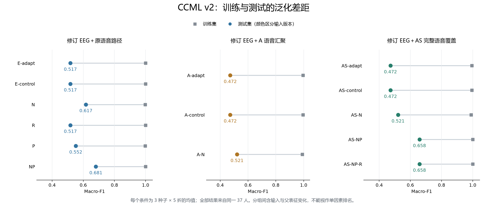

# CCML v2 总体总结与收尾报告

收尾日期：2026-09-24。范围：既定 v2 固定实验、已完成的原始 TRI-DEP EEG 补充对照及其解释边界。

## 1. 总体结论与收尾决定

**v2 既定固定实验执行完毕，现予收尾。本次仅核验和汇总，新增训练为 0。** Audit、E、N/R、P、NP、A、AS、AS-NP、AS-NP-R 均已完成。8 个训练阶段包含 14 个条件、210 组训练、50,400 次优化更新。每个条件均覆盖种子 11/22/33 × 5 折。原始 TRI-DEP 的 TC-00-E 作为独立补充对照列示，不计入 v2 的 CCML 训练预算。

旧语音路径的 **NP 是已执行 v2 条件中开发 Macro-F1 最高者：0.680895**；覆盖完整语音的 **AS-NP 为该版本的开发参考：0.658326**。两者不合并、不互相覆盖，也不宣称为独立验证的最优模型。AS-NP-R 未带来分类改善，不替换 AS-NP。

**当前不能认定已解决过拟合，也不能认定 CCML 已优于原始 TRI-DEP。** 输入修订、复现验收与泛化性能是三个不同结论：前两项已形成可追溯产物，泛化问题仍待后续独立设计验证。可选的 S 扩展、独立人群验证及原 TC-06 不标记为完成。

## 2. 评价口径与完成清单

全部主指标沿用预先约定口径：先求每个种子的五折指标算术均值，再求三个种子的均值。下文 F1 均指二分类 Macro-F1；NLL 和 Brier 越低越好。合并 OOF 指标另存于 results.json，不替代主口径。训练集、验证集分数也按同一折均值口径汇总。

独立受试者始终为 **37 人（HC 21、MDD 16）**。各折 train 为 27/26/26/27/27 人，val 均为 3 人，test 为 7/8/8/7/7 人。每个条件有 555 条全划分预测、111 条重复种子测试记录；全 v2 共 7,770 条预测、1,554 条测试记录，均不能当作新增独立样本。

| 阶段 | 固定条件 | 训练组数 | 优化更新数 | 完成记录 |
|---|---|---:|---:|---|
| E | E-adapt / E-control | 30 | 7,200 | [阶段报告](../../experiments/CCML-v2-E-37-fulltext/CCML-v2-E实验完成报告.md) |
| NR | N / R | 30 | 7,200 | [阶段报告](../../experiments/CCML-v2-NR-37-fulltext/CCML-v2-NR实验完成报告.md) |
| P | P | 15 | 3,600 | [阶段报告](../../experiments/CCML-v2-P-37-fulltext/CCML-v2-P实验完成报告.md) |
| NP | NP | 15 | 3,600 | [阶段报告](../../experiments/CCML-v2-NP-37-fulltext/CCML-v2-NP实验完成报告.md) |
| A | A-adapt / A-control / A-N | 45 | 10,800 | [阶段报告](../../experiments/CCML-v2-A-37-fulltext/CCML-v2-A实验完成报告.md) |
| AS | AS-adapt / AS-control / AS-N | 45 | 10,800 | [阶段报告](../../experiments/CCML-v2-AS-37-fulltext/CCML-v2-AS实验完成报告.md) |
| AS-NP | AS-NP | 15 | 3,600 | [阶段报告](../../experiments/CCML-v2-AS-NP-37-fulltext/CCML-v2-AS-NP实验完成报告.md) |
| AS-NP-R | AS-NP-R | 15 | 3,600 | [阶段报告](../../experiments/CCML-v2-AS-NP-R-37-fulltext/CCML-v2-AS-NP-R实验完成报告.md) |
| **v2 合计** | **14 个条件** | **210** | **50,400** | **全部完成** |

前置 [Audit 输入核查报告](../ccml_v2_audit/CCML-v2-Audit输入核查报告.md) 不涉及训练。以上均为每组 60 轮、batch 8、240 次更新、固定末轮检查点；未根据测试结果改阈值或提前停止。

## 3. 全部 v2 主结果

### 修订 EEG＋原语音路径

| 条件 | Macro-F1 | MDD recall | NLL | Brier | 本阶段可训练参数 |
|---|---:|---:|---:|---:|---:|
| E-adapt | 0.517126 | 0.405556 | 0.747174 | 0.268019 | 498,950 |
| E-control | 0.517126 | 0.405556 | 0.753317 | 0.269291 | 774 |
| N | 0.616845 | 0.466667 | 0.644753 | 0.221017 | 774 |
| R | 0.517126 | 0.405556 | 0.753320 | 0.269292 | 774 |
| P | 0.551739 | 0.450000 | 0.723996 | 0.254514 | 836,742 |
| NP | 0.680895 | 0.555556 | 0.647676 | 0.220458 | 836,742 |

### 修订 EEG＋A 语音汇聚

| 条件 | Macro-F1 | MDD recall | NLL | Brier | 本阶段可训练参数 |
|---|---:|---:|---:|---:|---:|
| A-adapt | 0.472030 | 0.394444 | 0.847665 | 0.310256 | 99,206 |
| A-control | 0.472030 | 0.394444 | 0.848196 | 0.310293 | 774 |
| A-N | 0.520859 | 0.388889 | 0.680778 | 0.236322 | 774 |

### 修订 EEG＋AS 完整语音覆盖

| 条件 | Macro-F1 | MDD recall | NLL | Brier | 本阶段可训练参数 |
|---|---:|---:|---:|---:|---:|
| AS-adapt | 0.472030 | 0.394444 | 0.844867 | 0.309309 | 99,206 |
| AS-control | 0.472030 | 0.394444 | 0.845422 | 0.309367 | 774 |
| AS-N | 0.520859 | 0.388889 | 0.671646 | 0.231166 | 774 |
| AS-NP | 0.658326 | 0.505556 | 0.588713 | 0.194751 | 476,294 |
| AS-NP-R | 0.658326 | 0.505556 | 0.588988 | 0.194855 | 476,294 |

参数列只计算该阶段实际更新参数，不代表从头训练的整个系统容量；冻结的父表征已包含同折训练集的监督学习。

### 历史参照（不计入 v2 训练预算）

| 历史条件 | Macro-F1 | MDD recall | NLL | Brier |
|---|---:|---:|---:|---:|
| [TC-01：原表征＋新 CE 头](../tc01/TC-01实验完成报告.md) | 0.699762 | 0.572222 | 0.601554 | 0.206824 |
| [TC-04：原表征＋完整 CCML](../tc04/TC-04实验完成报告.md) | 0.611614 | 0.488889 | 0.649417 | 0.230260 |

原始 TC-00 的选权与等权融合见第 6 节。不同输入、父表征及训练范围之间的成绩只作开发参照，不能据此单独归因于 CCML 损失。

### 配对比较与固定开发门槛

固定门槛为 F1 至少提高 0.01、至少 2/3 种子严格改善、召回下降不超过 0.05；同时披露 NLL/Brier。“通过”仅指开发门槛，不代表统计显著或独立验证。下表差值均为“候选减对照”；F1/召回用百分点，概率损失用原单位。

| 候选 / 对照 | ΔF1（百分点） | 改善种子 | Δ召回（百分点） | ΔNLL | ΔBrier | 开发门槛 |
|---|---:|---:|---:|---:|---:|---|
| N / E-control | +9.972 | 3/3 | +6.111 | -0.108564 | -0.048274 | 通过 |
| R / E-control | +0.000 | 0/3 | +0.000 | +0.000003 | +0.000002 | 未通过 |
| P / E-control | +3.461 | 1/3 | +4.444 | -0.029321 | -0.014777 | 未通过 |
| NP / N | +6.405 | 3/3 | +8.889 | +0.002923 | -0.000559 | 通过 |
| A-N / N | -9.599 | 0/3 | -7.778 | +0.036025 | +0.015305 | 未通过 |
| A-N / A-control | +4.883 | 3/3 | -0.556 | -0.167418 | -0.073970 | 通过 |
| AS-N / A-N | +0.000 | 0/3 | +0.000 | -0.009132 | -0.005156 | 未通过 |
| AS-N / AS-control | +4.883 | 3/3 | -0.556 | -0.173776 | -0.078200 | 通过 |
| AS-NP / AS-N | +13.747 | 3/3 | +11.667 | -0.082933 | -0.036415 | 通过 |
| AS-NP-R / AS-NP | +0.000 | 0/3 | +0.000 | +0.000275 | +0.000104 | 未通过 |

N 的规范化效果在同版本固定对照中得到支持；单独 P 的提升仅一个种子为正。旧 NP 相对 N 的 F1 改善较一致，但 NLL 略有恶化。A-N 相对旧 N 下降，不能用 A 版本内部规范化的改善掩盖这一结果。AS 完整覆盖改善概率指标和语音分支，但当时融合分类没有变化。AS-NP 相对 AS-N 改善了融合；AS-NP-R 的三个种子 F1 及全部 111 条测试分类均未改变，NLL/Brier 反而略差。

A-N / N 与 AS-N / A-N 为输入或表征版本修订比较，不能当作同一输入下的纯 N/P/R 主效应。旧 NP 与 AS-NP 也不构成单因素对照，跨版本差异不能直接解释为某一个模块的贡献。

## 4. 输入修订与模型变化：已经证实什么

- **EEG：**Audit 确认原 19 电极按索引选取存在偏移。E 改为按标签匹配，重新导出 37 人的 60×200 冻结骨干特征；原数值、滤波及参考策略保持不变。随后又进行了 CCML EEG CNN 与投影适配，因此 E 与旧 TC-04 的差异同时含输入修订和适配，不能单独归因于通道修订。
- **A 语音汇聚：**替换原冻结随机 CNN-BiGRU 汇聚路径及旧语音分类投影，采用片段均值、29 题等权均值的 768 维输入及可训练 768→128 投影。该阶段仍保留 96 个短音频题目的零向量，由下一阶段处理。
- **AS 短语音：**96 题按实际长度提取 HuBERT 特征，题目覆盖达到 1,073/1,073；977 题旧均值和 8 位原无空题受试者的汇聚向量不变。已完成长片段及短音频重提取精确复核。这是覆盖修复成功，不意味着融合 F1 必然上升。
- **AS-NP：**在同一 AS 输入下保留无仿射 LayerNorm，允许三路末端投影及新证据头更新，共 476,294 参数；沿用合法同折父初始化，未接着旧 NP 的训练后权重继续训练。
- **AS-NP-R：**仅将 Adamax weight_decay 从 0 改为 1e-4，作用于全部投影和证据头参数（含 bias）。该正则确实缩小参数范数，但没有解决本次测试分类与泛化差距；单一强度失败不等于所有正则方法无效。

EEG 电极标签已修订，但 GSN129/HydroCel 坐标模板对应关系和 Mumtaz 预训练输入幅值尺度的来源闭环仍未完成。本轮没有凭测试结果任意缩放输入，也不能将性能下降定论为幅值错误。

## 5. 过拟合与融合失效的收尾诊断

重新汇总保存预测后，**14 个条件中 6 个的全部训练预测均正确**，其余条件的平均训练 F1 也均不低于 0.9898。训练 F1=1 本身不足以判定严重程度；与下表持续存在的 train−test 差距一起，构成明显的泛化问题。这些是末轮、推理模式下的重代入训练分数，不是未见样本成绩。

| 条件 | Train F1 | Val F1 | Test F1 | Train−Test |
|---|---:|---:|---:|---:|
| E-adapt | 1.000000 | 0.436667 | 0.517126 | 0.482874 |
| E-control | 1.000000 | 0.436667 | 0.517126 | 0.482874 |
| N | 0.997432 | 0.632222 | 0.616845 | 0.380587 |
| R | 1.000000 | 0.436667 | 0.517126 | 0.482874 |
| P | 0.997337 | 0.476667 | 0.551739 | 0.445599 |
| NP | 1.000000 | 0.632222 | 0.680895 | 0.319105 |
| A-adapt | 0.994770 | 0.464444 | 0.472030 | 0.522740 |
| A-control | 0.994770 | 0.464444 | 0.472030 | 0.522740 |
| A-N | 0.989814 | 0.614444 | 0.520859 | 0.468955 |
| AS-adapt | 0.994770 | 0.464444 | 0.472030 | 0.522740 |
| AS-control | 0.994770 | 0.464444 | 0.472030 | 0.522740 |
| AS-N | 0.989814 | 0.614444 | 0.520859 | 0.468955 |
| AS-NP | 1.000000 | 0.800000 | 0.658326 | 0.341674 |
| AS-NP-R | 1.000000 | 0.800000 | 0.658326 | 0.341674 |

主要原因与证据边界如下：

1. **每折仅 26–27 人训练。**即使只有 774 个新头参数，输入也是已在同一训练折上监督拟合的父表征，不能把整条学习链理解成只有 774 个参数。AS-NP 又更新了 47.6 万参数，样本量与可拟合容量的差距更大。
2. **协议有利于训练分数饱和。**固定训练 60 轮，未使用早停；大多数条件 weight_decay=0。适配阶段的投影 dropout 沿用 eval 模式，因此相关随机失活没有在梯度更新时发挥正则作用。这些是复核到的配置，不是已经通过对照证明的唯一原因。
3. **CCML 与规范化不保证泛化。**CCML 的正确类证据掩码 KL 项并不直接禁止模型把训练样本拟合正确；LayerNorm 也不限制可记忆容量。F1 达到 1 只要求分类方向正确，不表示训练损失已经为 0。
4. **本次正则强度不足以改变观测结果。**AS-NP-R 与 AS-NP 都是 399/399 条训练记录分类正确，测试 F1 都为 0.658326。不能因有 weight_decay 就宣布过拟合已解决。
5. **开发集的反复查看带来选择偏差。**所有阶段反复使用同一 37 人与既有外层折；三个种子不是三批新受试者。已完成的名单与父权重审计未发现已检查环节的 train/test 人员混用，但这不能替代对所有潜在泄漏或自适应选择偏差的检验。

验证集每折只有 3 人，Val F1 波动很大，不能凭一个较高验证分数认定过拟合消失。原始 TRI-DEP 等权融合也出现 Train F1=1，因此该现象不能完全归咎于 v2 或 CCML。

### 语音分支改善为何不等于融合改善

| 条件 | 语音 Test F1 | 融合 Test F1 | 语音正确 / 111 | 融合正确 / 111 | 语音正确但融合错误 |
|---|---:|---:|---:|---:|---:|
| N | 0.638408 | 0.616845 | 76 | 73 | 16 |
| A-N | 0.782246 | 0.520859 | 88 | 66 | 26 |
| AS-N | 0.834786 | 0.520859 | 94 | 66 | 32 |
| AS-NP | 0.800714 | 0.658326 | 90 | 79 | 15 |
| AS-NP-R | 0.800714 | 0.658326 | 90 | 79 | 15 |

AS-NP 将“语音正确但融合错误”从 32 条降至 15 条，表明投影适配改善了部分模态共同作用；但语音单分支 F1 同时下降，且融合仍低于该分支。上述重复种子记录只用于诊断，不能据此按测试标签手调证据权重。

## 6. 独立补充：原始 TRI-DEP 使用修订 EEG

按用户后续明确要求，将 E 阶段通道标签修订后的 60×200 EEG 特征接入原始 TC-00 / B0-37-fulltext。该对照恢复原始 EEGConvPoolClassifier 的 CE 训练、原语音/文本权重和原概率融合；未使用 E 阶段经 CCML 训练的 EEG 聚合器或投影。因此它是用户单独指定的 CE 补充对照，v2 主线 CCML-only 的历史范围不变。

15 组新 EEG 训练、1,800 次更新完成；另有 15 组旧 EEG 训练、1,800 次更新用于精确重放原结果。新增实验与旧训练复现分开计数，不与 v2 的 210 组混加。

| 原始 TRI-DEP 输出 | 原 EEG F1 | 修订 EEG F1 | 差值（百分点） |
|---|---:|---:|---:|
| 验证集选权融合 | 0.724180 | 0.724180 | +0.000 |
| 等权融合 | 0.682487 | 0.656243 | -2.624 |
| EEG | 0.449401 | 0.411825 | -3.758 |
| 语音 | 0.630049 | 0.630049 | +0.000 |
| 文本 | 0.723069 | 0.723069 | +0.000 |

选权融合的 111 条测试分类全部相同；15 组中有 14 组的验证集选权给 EEG 权重为 0。所以融合 F1 不变不能证明 EEG 修订没有影响。等权融合有 5 条分类改变（1 条错变对、4 条对变错），EEG 分支有 15 条改变（6 条错变对、9 条对变错），两者平均 F1 下降。

这支持“标签修订并未在本次固定原始 TRI-DEP 协议下提高 EEG 分类性能”，不支持“应恢复已知错位的电极选择”。输入正确性与特定小样本协议的开发分数需要分别讨论。

详细核验见 [TC-00-E 原始 TRI-DEP 完成报告](../../experiments/TC-00-E-37-fulltext/TC-00-E原始TRIDEP实验完成报告.md).

## 7. 保留结果、未完成事项与下一阶段边界

| 结果 | 收尾角色 | 保留理由与限制 |
|---|---|---|
| AS-NP | 完整语音覆盖版本的开发参考 | 同版本相对 AS-N 改善；仍有明显泛化差距，不作为部署定版。 |
| 旧 NP | v2 历史开发 F1 最高参考 | 保留旧语音路径和 NLL 权衡，不能称为总体独立最优。 |
| N | 固定表征规范化对照 | 作为旧输入版本的低更新参数控制；冻结父表征仍有监督血缘。 |
| 其余全部条件 | 完整对照档案 | 保留权重、配置、历史报告和预测；未通过门槛者不自动升级。 |

“保留参考”均指既有 15 组折/种子检查点及其预测集合；本轮没有重新全人群训练一个最终权重，也没有选出可部署的单一模型。每个检查点的路径和哈希见 results.json 的 conditions → runs。

| 未完成事项 | 收尾处理 |
|---|---|
| 可选 CCML-v2-S 证据缩放、动态门控或新融合损失 | 尚未执行，涉及方法扩展；不因现有测试分数自动启动。 |
| 独立 AS-R / AS-P 主效应对照 | 尚未执行；属于可追加的因子分解，不伪称本轮已经验证。 |
| EEG 输入幅值与坐标模板来源闭环 | 仍待原数据说明、上游预训练处理依据核实；不凭性能反推正确单位。 |
| 泛化确认 | 尚缺未反复用于开发的独立验证人群；现有分数不能当作最终泛化证明。 |
| 原 TC-06 CE/CCML 配对解冻 | 原计划保留项，不属于此次 v2 完成范围，不标记完成。 |

若另立下一阶段，应先固定主要问题、合法训练内验证方案和比较预算，再评估正则/容量/融合变化。同一数据上的嵌套验证有助于规范未来选择，但不能追溯性消除已经发生的反复开发；最终仍需独立数据确认。**当前没有自动续跑或新增超参数搜索任务。**

## 8. 收尾核验与可追溯产物

本轮重新校验 4,860 个不同来源文件的哈希，核对 210 组运行身份、划分和更新预算，检查 7,770 条 CCML 预测的数值关系，从保存预测重新计算全部 14 个条件的主指标与合并 OOF 指标，并复核 10 个配对开发门槛；结果与阶段验收一致。

本轮没有重复检查点推理或重新训练。阶段完成时已保存的精确预测重载、独立指标交叉核验和测试结果继续作为其原始验收证据：最后 v2 阶段累计 89 项测试通过，TC-00-E 补充对照 19 项测试通过；不把各阶段重叠测试数相加为新的独立覆盖。历史配置、代码、计划正文、预测与检查点保持原样；只新增本收尾目录与汇总程序，并更新两份导航 README。

- [机器可读收尾状态](status.json)
- [完整重算结果、配对差值、划分指标与检查点索引](results.json)
- [本轮核验摘要](verification.json)
- [来源文件哈希清单](verified_sources.json)
- [收尾前历史保护快照](historical_snapshot.json)
- [训练与测试对照图](训练与测试泛化差距.png)
- [原始 v2 计划（历史快照）](../../../output/plans/CCML_v2_性能优化与后续计划.md)
- [计划总索引](../../../output/plans/README.md)

状态优先级：本收尾状态描述当前 v2 总体状态；各阶段旧报告中的“下一步”“尚未启动”等文字仅描述当时快照。既有 TC 阶段 experiment_status.json 继续保留其历史含义。
