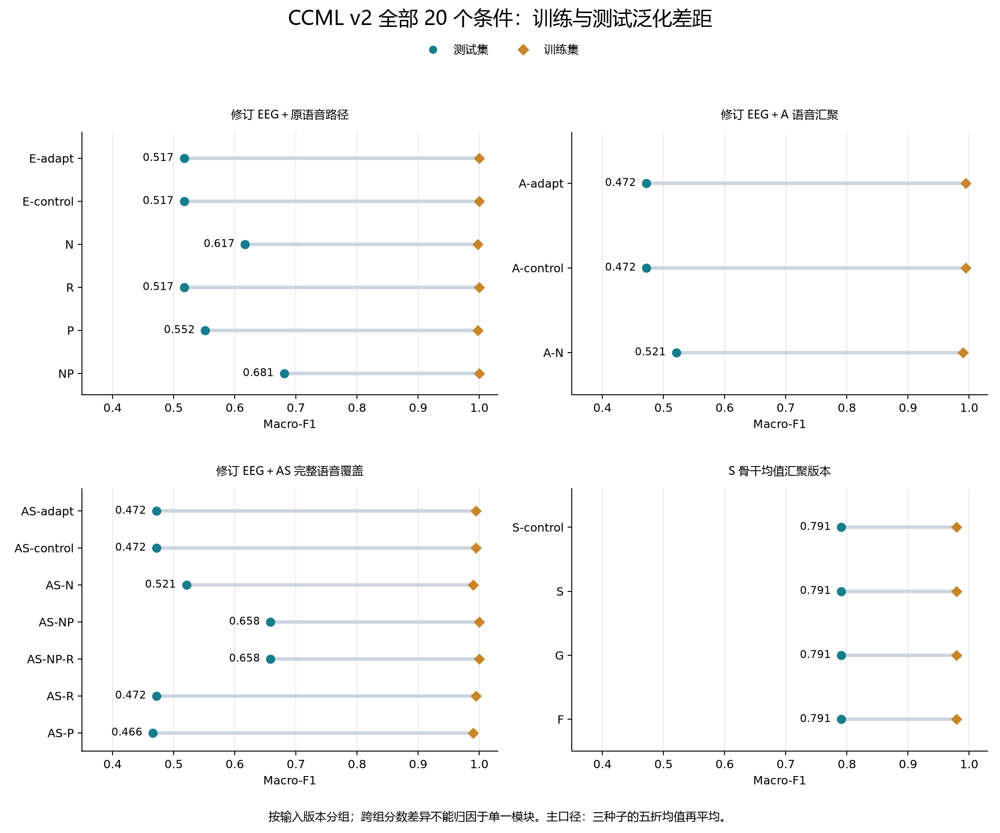

# CCML v2 总体总结与收尾报告（含全部已登记可选实验）

更新日期：2026-09-24。范围：Audit 至 AS-NP-R 的原固定阶段、S、AS-R/AS-P、G/F，以及单列的原始 TRI-DEP EEG 修订补充对照。

## 1. 总体结论与收尾决定

**v2 原固定阶段与全部已登记可选实验均已完成并验收。累计 20 个外层条件、570 组训练（300 组外层＋270 组内层）、120,600 次优化更新。本次总结更新新增训练为 0。**

**现有 v2 开发结果中的最高 Macro-F1 为 0.790859，由 S-control、S、G、F 并列取得，MDD recall 均为 0.666667。** 这是 S 骨干均值汇聚版本的成绩。S 静态尺度、G 动态门控、F 额外最终融合监督相对同版本控制均未改变 111 条测试分类，均未通过预先固定的分类提升门槛；不能将较高分数归功于这些扩展。

AS-R 的 F1 为 0.472030，与 AS-control 相同；AS-P 为 0.465902，低于 AS-control。二者也均未通过开发门槛。**本次五项可选候选 S、AS-R、AS-P、G、F 均已执行，但没有一项达到预定分类提升门槛。** G/F 的 NLL、Brier 略有改善，只作为概率指标结果保留。

旧 NP（0.680895）仍是旧语音路径中的开发 F1 最高参考；AS-NP（0.658326）仍是旧 AS 监督父表征版本的参考。旧报告中“NP 为全部 v2 最高”仅描述 S 开始前的范围，已由本报告更新。S-control 保留为新均值版本的开发比较基准；未选出部署模型。

**泛化差距尚未消除，也不能据此认定 CCML 已独立验证优于原始 TRI-DEP。** 新版本 train−test F1 差距为 0.188669，较旧 AS-NP 的 0.341674 小，但结构、输入维度与监督初始化同时变化；这不构成单一改动效果或独立人群验证。

## 2. 评价口径与完整完成清单

主指标保持原约定：先求每个种子的五折指标算术均值，再求三个种子的均值。F1 均指二分类 Macro-F1；NLL/Brier 越低越好。合并 OOF 指标另存于 results.json，不替代主口径。固定种子 11/22/33、五个外折、60 轮、batch 8、末轮检查点和 0.5 阈值；不选择最优种子或测试阈值。

独立受试者仍为 **37 人（HC 21、MDD 16）**。各折 train 为 27/26/26/27/27 人，val 均为 3 人，test 为 7/8/8/7/7 人。每个外层条件包含 555 条全划分预测和 111 条重复种子测试记录；全部 20 个条件合计 11,100 条外层预测、2,220 条外层测试记录。270 组内层训练的 7,182 条预测另列，不能计为额外独立受试者或外层测试记录。

| 阶段 | 外层条件 | 外层训练 | 内层训练 | 训练合计 | 更新合计 | 完成报告 |
|---|---|---:|---:|---:|---:|---|
| E | E-adapt / E-control | 30 | 0 | 30 | 7,200 | [已完成](../../experiments/CCML-v2-E-37-fulltext/CCML-v2-E实验完成报告.md) |
| NR | N / R | 30 | 0 | 30 | 7,200 | [已完成](../../experiments/CCML-v2-NR-37-fulltext/CCML-v2-NR实验完成报告.md) |
| P | P | 15 | 0 | 15 | 3,600 | [已完成](../../experiments/CCML-v2-P-37-fulltext/CCML-v2-P实验完成报告.md) |
| NP | NP | 15 | 0 | 15 | 3,600 | [已完成](../../experiments/CCML-v2-NP-37-fulltext/CCML-v2-NP实验完成报告.md) |
| A | A-adapt / A-control / A-N | 45 | 0 | 45 | 10,800 | [已完成](../../experiments/CCML-v2-A-37-fulltext/CCML-v2-A实验完成报告.md) |
| AS | AS-adapt / AS-control / AS-N | 45 | 0 | 45 | 10,800 | [已完成](../../experiments/CCML-v2-AS-37-fulltext/CCML-v2-AS实验完成报告.md) |
| AS-NP | AS-NP | 15 | 0 | 15 | 3,600 | [已完成](../../experiments/CCML-v2-AS-NP-37-fulltext/CCML-v2-AS-NP实验完成报告.md) |
| AS-NP-R | AS-NP-R | 15 | 0 | 15 | 3,600 | [已完成](../../experiments/CCML-v2-AS-NP-R-37-fulltext/CCML-v2-AS-NP-R实验完成报告.md) |
| S | S-control / S | 30 | 90 | 120 | 23,400 | [已完成](../../experiments/CCML-v2-S-37-fulltext/CCML-v2-S实验完成报告.md) |
| AS-RP | AS-R / AS-P | 30 | 0 | 30 | 7,200 | [已完成](../../experiments/CCML-v2-AS-RP-37-fulltext/CCML-v2-AS-RP实验完成报告.md) |
| GF | G / F | 30 | 180 | 210 | 39,600 | [已完成](../../experiments/CCML-v2-GF-37-fulltext/CCML-v2-GF实验完成报告.md) |
| **v2 累计** | **20 个条件** | **300** | **270** | **570** | **120,600** | **全部完成** |

Audit 输入核查不涉及训练。原固定阶段为 210 组/50,400 次更新；S 为 120 组/23,400 次；后续 AS-R/P＋G/F 为 240 组/46,800 次。AS-R/P 复用的 AS-control 与 G/F 复用的 S-control 均只计一次。外层每组 240 次更新，内层每组 180 次更新。TC-00-E 的新 EEG CE 训练及旧训练重放在第 6 节单列，不计入 v2。

## 3. 全部 v2 主结果与配对比较

### 修订 EEG＋原语音路径

| 条件 | Macro-F1 | MDD recall | NLL | Brier | 本阶段可训练参数 |
|---|---:|---:|---:|---:|---:|
| E-adapt | 0.517126 | 0.405556 | 0.747174 | 0.268019 | 498,950 |
| E-control | 0.517126 | 0.405556 | 0.753317 | 0.269291 | 774 |
| N | 0.616845 | 0.466667 | 0.644753 | 0.221017 | 774 |
| R | 0.517126 | 0.405556 | 0.753320 | 0.269292 | 774 |
| P | 0.551739 | 0.450000 | 0.723996 | 0.254514 | 836,742 |
| NP | 0.680895 | 0.555556 | 0.647676 | 0.220458 | 836,742 |

### 修订 EEG＋A 语音汇聚

| 条件 | Macro-F1 | MDD recall | NLL | Brier | 本阶段可训练参数 |
|---|---:|---:|---:|---:|---:|
| A-adapt | 0.472030 | 0.394444 | 0.847665 | 0.310256 | 99,206 |
| A-control | 0.472030 | 0.394444 | 0.848196 | 0.310293 | 774 |
| A-N | 0.520859 | 0.388889 | 0.680778 | 0.236322 | 774 |

### 修订 EEG＋AS 完整语音覆盖

| 条件 | Macro-F1 | MDD recall | NLL | Brier | 本阶段可训练参数 |
|---|---:|---:|---:|---:|---:|
| AS-adapt | 0.472030 | 0.394444 | 0.844867 | 0.309309 | 99,206 |
| AS-control | 0.472030 | 0.394444 | 0.845422 | 0.309367 | 774 |
| AS-N | 0.520859 | 0.388889 | 0.671646 | 0.231166 | 774 |
| AS-NP | 0.658326 | 0.505556 | 0.588713 | 0.194751 | 476,294 |
| AS-NP-R | 0.658326 | 0.505556 | 0.588988 | 0.194855 | 476,294 |
| AS-R | 0.472030 | 0.394444 | 0.845414 | 0.309365 | 774 |
| AS-P | 0.465902 | 0.350000 | 0.790469 | 0.283781 | 476,294 |

### S 骨干均值汇聚版本

| 条件 | Macro-F1 | MDD recall | NLL | Brier | 本阶段可训练参数 |
|---|---:|---:|---:|---:|---:|
| S-control | 0.790859 | 0.666667 | 0.494859 | 0.158180 | 223,366 |
| S | 0.790859 | 0.666667 | 0.494695 | 0.158218 | 223,369 |
| G | 0.790859 | 0.666667 | 0.492416 | 0.157260 | 223,375 |
| F | 0.790859 | 0.666667 | 0.493093 | 0.157519 | 223,366 |

参数只统计本阶段更新范围；旧版本冻结父表征已包含同折训练集的监督学习。新均值版本无旧 MODMA 监督父权重。**表格按输入/表征版本分组，跨组不能视为单因素对照。**

### 历史参照与比较边界

TC-01（原表征＋新 CE 头）的 F1 为 0.699762，TC-04（原表征＋完整 CCML）为 0.611614；原始 TRI-DEP 验证集选权融合为 0.724180。新均值版本 0.790859 在数值上较 0.724180 高 6.668 个百分点，但输入、结构、训练范围与融合策略不同，且人群已被反复用于开发，因此不能作为 CCML 损失本身优于 CE 或原始 TRI-DEP 的独立证据。

### 固定开发门槛

门槛为 F1 至少提高 0.01、至少 2/3 种子严格改善、MDD recall 下降不超过 0.05，同时披露 NLL/Brier。差值均为候选减对照；F1/召回用百分点，概率损失用原单位。“通过”仅指开发门槛，不代表统计显著。

| 候选 / 对照 | ΔF1（百分点） | 改善种子 | Δ召回（百分点） | ΔNLL | ΔBrier | 开发门槛 |
|---|---:|---:|---:|---:|---:|---|
| N / E-control | +9.972 | 3/3 | +6.111 | -0.108564 | -0.048274 | 通过 |
| R / E-control | +0.000 | 0/3 | +0.000 | +0.000003 | +0.000002 | 未通过 |
| P / E-control | +3.461 | 1/3 | +4.444 | -0.029321 | -0.014777 | 未通过 |
| NP / N | +6.405 | 3/3 | +8.889 | +0.002923 | -0.000559 | 通过 |
| A-N / N | -9.599 | 0/3 | -7.778 | +0.036025 | +0.015305 | 未通过 |
| A-N / A-control | +4.883 | 3/3 | -0.556 | -0.167418 | -0.073970 | 通过 |
| AS-N / A-N | +0.000 | 0/3 | +0.000 | -0.009132 | -0.005156 | 未通过 |
| AS-N / AS-control | +4.883 | 3/3 | -0.556 | -0.173776 | -0.078200 | 通过 |
| AS-NP / AS-N | +13.747 | 3/3 | +11.667 | -0.082933 | -0.036415 | 通过 |
| AS-NP-R / AS-NP | +0.000 | 0/3 | +0.000 | +0.000275 | +0.000104 | 未通过 |
| S / S-control | +0.000 | 0/3 | +0.000 | -0.000164 | +0.000038 | 未通过 |
| AS-R / AS-control | +0.000 | 0/3 | +0.000 | -0.000007 | -0.000002 | 未通过 |
| AS-P / AS-control | -0.613 | 1/3 | -4.444 | -0.054953 | -0.025586 | 未通过 |
| G / S-control | +0.000 | 0/3 | +0.000 | -0.002443 | -0.000920 | 未通过 |
| F / S-control | +0.000 | 0/3 | +0.000 | -0.001766 | -0.000661 | 未通过 |

原固定阶段对规范化 N、同版本 NP 及 AS-NP 的改善已有开发证据；单独 P 和固定强度正则未稳定改善。AS-P 补充对照表明：在旧 AS 输入下，只增加投影适配、没有 N 时，分类不升反降，不能把 AS-NP 的改善直接归为 P 的独立效果。A-N/N、AS-N/A-N 涉及输入或表征修订；旧 NP 与 AS-NP 也不是单因素对照。

S/G/F 均与各自同版本 S-control 比较。三者每个种子的 F1 及测试分类不变，不能把新版本共同达到 0.790859 解释成三种扩展各自有效。

## 4. 输入修订、可选方法与验证设计

- **EEG：**Audit 确认原 19 电极按索引选取存在偏移。E 改为按标签匹配，重新导出 37 人的 60×200 冻结骨干特征；原数值、滤波及参考策略保持不变。随后又进行了 CCML EEG CNN 与投影适配，因此 E 与旧 TC-04 的差异同时含输入修订和适配，不能单独归因于通道修订。
- **A 语音汇聚：**替换原冻结随机 CNN-BiGRU 汇聚路径及旧语音分类投影，采用片段均值、29 题等权均值的 768 维输入及可训练 768→128 投影。该阶段仍保留 96 个短音频题目的零向量，由下一阶段处理。
- **AS 短语音：**96 题按实际长度提取 HuBERT 特征，题目覆盖达到 1,073/1,073；977 题旧均值和 8 位原无空题受试者的汇聚向量不变。已完成长片段及短音频重提取精确复核。这是覆盖修复成功，不意味着融合 F1 必然上升。
- **AS-NP：**在同一 AS 输入下保留无仿射 LayerNorm，允许三路末端投影及新证据头更新，共 476,294 参数；沿用合法同折父初始化，未接着旧 NP 的训练后权重继续训练。
- **AS-NP-R：**仅将 Adamax weight_decay 从 0 改为 1e-4，作用于全部投影和证据头参数（含 bias）。该正则确实缩小参数范数，但没有解决本次测试分类与泛化差距；单一强度失败不等于所有正则方法无效。

EEG 电极标签已修订，但 GSN129/HydroCel 坐标模板对应关系和 Mumtaz 预训练输入幅值尺度的来源闭环仍未完成。本轮没有凭测试结果任意缩放输入，也不能将性能下降定论为幅值错误。

### 已完成的五项可选候选

- **AS-R / AS-P：**与旧 AS-control 使用相同父版本、初始化和批序。AS-R 仅增加证据头 weight_decay=1e-4；AS-P 仅开放三路末端投影更新、无 LayerNorm。完整 CCML 保留，两项均未通过分类门槛。
- **S：**为合法训练内验证建立 S-backbone-mean-v1。EEG 为修订 CBraMod 时间均值，语音为 AS 完整 29 题 HuBERT 均值，文本为全文 MacBERT 29 题 CLS 均值；三路新建 Linear→ReLU→无仿射 LayerNorm128→证据头。无旧 MODMA 监督初始化。S 在解耦前学习三个 [0.5,2] 的模态尺度，并向 1 收缩。
- **G：**在同一均值版本上增加 9 个逐人门控参数，根据各模态本人的原始不确定性 u 和类别概率差生成 [0.5,2] 尺度；特征停止梯度，尺度向 1 收缩。
- **F：**在同一均值版本上给最终融合 Dirichlet 输出增加期望交叉熵监督，无额外最终 KL、无缩放、无动态门控。G/F 保留完整 CCML，不叠加 S 或彼此。

S/G/F 每个外层 train 内固定三折分层，所有监督参数仅在对应 inner-train 重新拟合。S/G 从 0.01/0.1 两个收缩强度中选择，F 从 0.1/1.0 两个监督权重中选择；准则为三折 inner-val 融合 NLL。S/G 平票取较大收缩，F 平票取较小监督权重（容差 1e-12）。S 的 15 份选择与后续 G/F 的 30 份选择分别全部锁定后才运行相应外层模型，外层 val/test 未用于本次强度选择。

选择次数：S：0.1 → 6/15、0.01 → 9/15；G：0.1 → 8/15、0.01 → 7/15；F：0.1 → 3/15、1.0 → 12/15。未追加候选或强度搜索。

**合法内层选择改进了本次参数选择流程，但没有消除此前在同一 37 人上反复开发所带来的选择偏差。**

## 5. 过拟合与融合诊断的更新

旧 14 个条件中 6 个全部训练分类正确，其余平均训练 F1 均不低于 0.9898。新增 AS-R/P 的 train−test 差距仍约 0.52。S-control/S/G/F 的训练 F1 降至 0.979528、测试 F1 为 0.790859，差距缩小到 0.188669，但仍明显存在。S/G/F 相对直接控制的训练、验证、测试分类指标均相同，未显示额外缓解泛化差距。

| 条件 | Train F1 | Val F1 | Test F1 | Train−Test |
|---|---:|---:|---:|---:|
| E-adapt | 1.000000 | 0.436667 | 0.517126 | 0.482874 |
| E-control | 1.000000 | 0.436667 | 0.517126 | 0.482874 |
| N | 0.997432 | 0.632222 | 0.616845 | 0.380587 |
| R | 1.000000 | 0.436667 | 0.517126 | 0.482874 |
| P | 0.997337 | 0.476667 | 0.551739 | 0.445599 |
| NP | 1.000000 | 0.632222 | 0.680895 | 0.319105 |
| A-adapt | 0.994770 | 0.464444 | 0.472030 | 0.522740 |
| A-control | 0.994770 | 0.464444 | 0.472030 | 0.522740 |
| A-N | 0.989814 | 0.614444 | 0.520859 | 0.468955 |
| AS-adapt | 0.994770 | 0.464444 | 0.472030 | 0.522740 |
| AS-control | 0.994770 | 0.464444 | 0.472030 | 0.522740 |
| AS-N | 0.989814 | 0.614444 | 0.520859 | 0.468955 |
| AS-NP | 1.000000 | 0.800000 | 0.658326 | 0.341674 |
| AS-NP-R | 1.000000 | 0.800000 | 0.658326 | 0.341674 |
| AS-R | 0.994770 | 0.464444 | 0.472030 | 0.522740 |
| AS-P | 0.989677 | 0.486667 | 0.465902 | 0.523775 |
| S-control | 0.979528 | 0.770000 | 0.790859 | 0.188669 |
| S | 0.979528 | 0.770000 | 0.790859 | 0.188669 |
| G | 0.979528 | 0.770000 | 0.790859 | 0.188669 |
| F | 0.979528 | 0.770000 | 0.790859 | 0.188669 |

每折仅 26–27 人训练，固定 60 轮且无早停；旧适配阶段的投影 dropout 沿用 eval 模式，新均值版本没有 dropout。旧父表征具有监督拟合历史，新均值版本虽减少更新参数并重建监督部分，仍约 22.3 万参数。样本量、模型容量、训练协议和反复开发均是需要考虑的因素；这些配置与差距不是已由单一对照证明的唯一原因。LayerNorm、CCML 证据约束及一次固定强度正则均不能保证泛化。

训练分数为末轮推理模式下的重代入成绩；每折验证集只有 3 人，较高 Val F1 也不能证明过拟合已消除。原始 TRI-DEP 等权融合同样出现 Train F1=1。

### 语音分支与融合的版本差异

| 条件 | 语音 Test F1 | 融合 Test F1 | 语音正确 / 111 | 融合正确 / 111 | 语音正确但融合错误 |
|---|---:|---:|---:|---:|---:|
| N | 0.638408 | 0.616845 | 76 | 73 | 16 |
| A-N | 0.782246 | 0.520859 | 88 | 66 | 26 |
| AS-N | 0.834786 | 0.520859 | 94 | 66 | 32 |
| AS-NP | 0.800714 | 0.658326 | 90 | 79 | 15 |
| AS-NP-R | 0.800714 | 0.658326 | 90 | 79 | 15 |
| AS-R | 0.593030 | 0.472030 | 78 | 57 | 29 |
| AS-P | 0.715118 | 0.465902 | 86 | 59 | 28 |
| S-control | 0.777540 | 0.790859 | 88 | 90 | 9 |
| S | 0.777540 | 0.790859 | 88 | 90 | 9 |
| G | 0.777540 | 0.790859 | 88 | 90 | 9 |
| F | 0.769921 | 0.790859 | 87 | 90 | 8 |

旧 AS-NP 将“语音正确但融合错误”从 AS-N 的 32 条降至 15 条，但融合仍低于其语音分支。新均值版本控制的语音 F1 为 0.777540，融合为 0.790859，“语音正确但融合错误”为 9 条；因此旧报告中“融合始终弱于语音”的诊断不能直接推广到新版本。该变化涉及多处结构/输入差异，仍不能归因于 S/G/F。所有 111 条均为重复种子诊断记录，不用于按测试标签手调模态权重。

## 6. 独立补充：原始 TRI-DEP 使用修订 EEG

按用户后续明确要求，将 E 阶段通道标签修订后的 60×200 EEG 特征接入原始 TC-00 / B0-37-fulltext。该对照恢复原始 EEGConvPoolClassifier 的 CE 训练、原语音/文本权重和原概率融合；未使用 E 阶段经 CCML 训练的 EEG 聚合器或投影。因此它是用户单独指定的 CE 补充对照，v2 主线 CCML-only 的历史范围不变。

15 组新 EEG 训练、1,800 次更新完成；另有 15 组旧 EEG 训练、1,800 次更新用于精确重放原结果。新增实验与旧训练复现分开计数，不与 v2 累计的 570 组混加。

| 原始 TRI-DEP 输出 | 原 EEG F1 | 修订 EEG F1 | 差值（百分点） |
|---|---:|---:|---:|
| 验证集选权融合 | 0.724180 | 0.724180 | +0.000 |
| 等权融合 | 0.682487 | 0.656243 | -2.624 |
| EEG | 0.449401 | 0.411825 | -3.758 |
| 语音 | 0.630049 | 0.630049 | +0.000 |
| 文本 | 0.723069 | 0.723069 | +0.000 |

选权融合的 111 条测试分类全部相同；15 组中有 14 组的验证集选权给 EEG 权重为 0。所以融合 F1 不变不能证明 EEG 修订没有影响。等权融合有 5 条分类改变（1 条错变对、4 条对变错），EEG 分支有 15 条改变（6 条错变对、9 条对变错），两者平均 F1 下降。

这支持“标签修订并未在本次固定原始 TRI-DEP 协议下提高 EEG 分类性能”，不支持“应恢复已知错位的电极选择”。输入正确性与特定小样本协议的开发分数需要分别讨论。

详细核验见 [TC-00-E 原始 TRI-DEP 完成报告](../../experiments/TC-00-E-37-fulltext/TC-00-E原始TRIDEP实验完成报告.md).

## 7. 保留结果、完成状态与下一阶段边界

| 结果 | 当前角色 | 理由与限制 |
|---|---|---|
| S-control | 新骨干均值版本的开发比较基准 | F1=0.790859；S/G/F 未带来分类增益，控制较简洁。该角色不等于部署选模。 |
| S / G / F | 已完成的固定方法扩展档案 | 与控制分类相同；保留概率指标和选择记录，不升级为默认。 |
| AS-NP | 旧 AS 监督父表征版本的开发参考 | 同版本相对 AS-N 改善；F1=0.658326，不与新均值版本混作单因素比较。 |
| 旧 NP | 旧语音路径的历史开发参考 | F1=0.680895；已不代表含 S/G/F 后的全部 v2 最高分。 |
| N | 旧固定表征规范化对照 | 保留低更新参数控制及其监督父表征血缘。 |
| AS-R / AS-P 与其余固定条件 | 完整对照档案 | 全部已完成；未通过门槛者不自动升级。 |

各条件保留 15 组外层折/种子检查点与预测；S/G/F 另保留全部 270 组内层检查点与选择记录。检查点索引分别见 results.json 的 conditions → runs 和 inner_runs。未在全部人群上另训最终权重，未选出可部署的单一模型。

| 事项 | 当前状态与边界 |
|---|---|
| 原固定阶段、S、AS-R、AS-P、G、F | 全部已完成；本轮已登记可选实验没有待执行项。 |
| EEG 输入幅值与坐标模板来源闭环 | 仍缺原采集/预训练处理依据；不能凭开发分数反推正确单位或模板。 |
| 独立泛化验证 | 尚缺未反复用于开发的新标注人群；更多种子或原 37 人重新划分不能替代。 |
| 原 TC-06 CE/CCML 配对解冻 | 属于 v2 之外的原计划保留项，未执行，不标记完成。 |
| G+F、soft-min、模态丢弃及额外强度搜索 | 未登记为本轮固定候选，不计为可选实验欠项，也未启动。 |

**本次全部已登记实验完成；研究中的外部证据缺口与独立验证缺口仍保留。当前没有后续已登记训练或自动搜索。**

## 8. 本次核验与可追溯产物

本次总结更新重新校验 2,310 个来源文件哈希，核对 570 组训练的预算及运行索引，检查 11,100 条外层预测的人员划分、标签、阈值分类与覆盖，从保存预测重算全部 20 个条件的主指标、合并 OOF 与 train/val/test 指标，并重算 15 个配对门槛。结果与已验收阶段一致；复用控制未重复计数。

本次未重新训练、未重新运行检查点推理、未重复执行模型测试或内层强度选择。以下为各阶段完成时已有验收证据，不能写作本次新增测试：

| 阶段验收 | 已记录证据 |
|---|---|
| 原固定 v2 收尾 | 210 组、7,770 条预测、14 个条件、10 个比较；当时重核 4,860 个来源文件，末阶段累计 89 项测试通过。 |
| S | 41 项测试；120 个检查点和 3,504 条预测精确重载；15 份内层选择复算，30 个外层测试折指标交叉核验。 |
| AS-R/P | 33 项测试；30 个检查点和 1,110 条新预测精确重载；30 个新增外层测试折指标交叉核验。 |
| G/F | 39 项测试；210 个检查点和 5,898 条新预测精确重载；30 份内层选择复算，30 个新增外层测试折指标交叉核验。 |
| TC-00-E（单列） | 19 项测试；修订 EEG 训练和旧 EEG 精确重放均完成。 |

各阶段测试含重叠项目，不相加宣称独立测试覆盖；历史哈希保护数字也不叠加。旧收尾目录、可选总结、阶段配置、报告、预测和权重保持原样。本次新增完整总结目录及其汇总程序，并更新两份导航 README。

- [当前完整完成状态](status.json)
- [全部重算指标、配对差值和外层/内层检查点索引](results.json)
- [本次核验摘要](verification.json)
- [本次来源哈希清单](verified_sources.json)
- [此前两份收尾的保护快照](previous_closeouts_snapshot.json)
- [原固定阶段收尾（历史快照）](../ccml_v2_closeout/CCML-v2总体总结与收尾报告.md)
- [剩余可选实验总结（阶段快照）](../ccml_v2_optional_closeout/CCML-v2剩余可选实验总结.md)
- [计划总索引](../../../output/plans/README.md)

状态优先级：本报告及同目录 status.json 描述当前完整 v2 状态；旧阶段中的“可选尚未执行”“旧 NP 最高”等文字仅描述各自生成时点。
